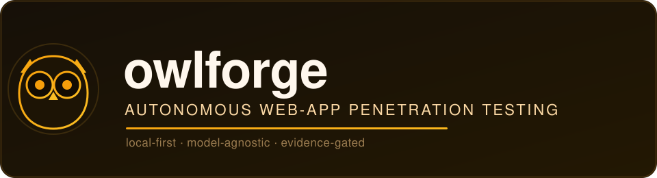
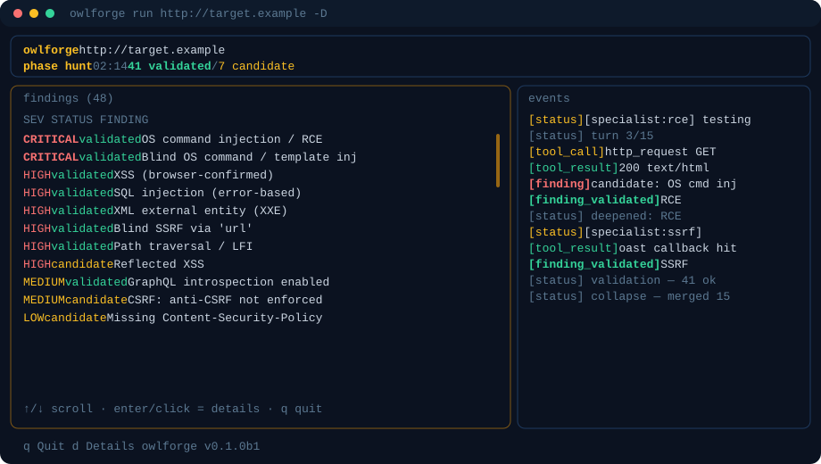

<p align="center">
  
</p>

<p align="center">
  
  
  
  
</p>

A **local-first, model-agnostic, autonomous web-application penetration-testing
platform**. Point it at an authorized target and a model you choose drives the whole
assessment — recon → understanding → authentication → planning → multi-agent testing →
evidence-gated validation → report — with all tooling running inside an isolated sandbox
container you build yourself.

Original work — its own architecture and engine, built from the ground up.

> ⚠️ **Status: active development.** The engine works end to end on real targets;
> interfaces and schema still change. **Only test systems you are authorized to assess.**

> **Usage guide:** worked examples (authenticated IDOR, OAST config, reading results) are in [docs/USAGE.md](docs/USAGE.md).

## Demo

A live run in the interactive dashboard (`-D`) — scrollable findings table, click a row for the full finding, live event log:

<p align="center">
  
</p>

> _Illustrative layout; findings shown are representative of a run against a deliberately-vulnerable test app._

Prefer plain output? Omit `-D` for a scrollable streaming log (and `-n` for headless CI).

## Why local-first
owlforge is built to be driven by a **local** model (any OpenAI-compatible endpoint —
Ollama / Jan / LM Studio / llama.cpp). Designing for a modest local model forces a robust,
model-agnostic harness: the deterministic recon, pre-probe, and evidence gate do the
reliable work, so the model doesn't have to. That same harness then runs **even better on
a frontier model** through the identical OpenAI-compatible path — no special-casing.

## How it works
```
SETUP → RECON → UNDERSTAND → AUTH → PLAN → HUNT → VALIDATE → DEEPEN → dedupe → REPORT
        (always   (secrets/   (auto-  (orchestr-  (special-  (evidence   (opt-in
         unauth    PII/JS→API)  escal-  ator +      ist        gate)       read-only
         first)                 ate)    PRE-PROBE)  agents)                proof)
```
- **Recon is deterministic.** A crawler + ffuf content-discovery + katana (JS-aware
  crawl) + JS/param extraction + fingerprint + wafw00f (WAF/CDN detection) map the
  surface. For JS-heavy SPAs it adds **browser-driven interactive
  recon** (real Chromium navigates routes, clicks menus/tabs, and captures every
  XHR/fetch/websocket the app makes) so dynamically-built API endpoints that never appear
  in the raw HTML are discovered too — non-destructively (it never submits forms).
- **Auth is one pipeline, not a mode.** Unauth recon runs first; owlforge then
  auto-escalates to an authenticated pass when credentials are provided, discovered
  (leaked in JS/exposed files), or **harvested from the login page**. SSO/MFA is captured
  via a headed in-sandbox browser exposed over noVNC (human-in-the-loop); TOTP is
  automated (RFC-6238).
- **Planning gates the model.** The orchestrator classifies every parameter and a
  deterministic **pre-probe** tests each gateable class first; it **auto-files** findings
  it confirms itself, so recall never depends on the model remembering to file.
- **Specialists** are focused per-class agents (SQLi/XSS/SSRF/…), with an enforced
  **bypass loop** when a signal is confirmed but the agent gives up.
- **Validation is evidence-gated.** A finding is `validated` only if owlforge reproduces
  its proof — SQLi by re-issuing the structured PoC and matching the signal, **XSS by
  actual browser execution** (encoded/non-executing reflections are rejected),
  access-control by **differential testing** across identities. No model assertion counts
  as proof.
- **Found secrets, keys, and PII are reported IN FULL** as evidence — owlforge does not
  redact what it proves.
- **Exploit chaining.** After validation, owlforge correlates already-validated findings
  into higher-impact attack paths (credentialed access → IDOR/privilege escalation;
  SSRF → cloud instance metadata) — described, never further exploited.
- **Findings confirm live.** Validation runs incrementally — each specialist's findings
  are evidence-checked the moment it finishes, so confirmed issues surface mid-scan
  instead of only at the end.
- **Methodology knowledge packs.** Per-class / per-framework markdown packs
  (`owlforge/knowledge/`) are injected into the relevant specialist's prompt, matched
  to what recon fingerprinted — deepen coverage by adding a file, not code.
- **Targets include API descriptions.** Point it at an OpenAPI/Swagger (JSON/YAML) or
  Postman collection and every operation is tested without crawling.

Vuln classes: SQLi · reflected/DOM/stored XSS · access-control (IDOR + horizontal/vertical
privesc) · path-traversal · SSRF · open-redirect · CRLF · CSRF · SSTI · RCE · NoSQL · XXE ·
deserialization · file-upload · GraphQL · info-disclosure · WebSocket · request-smuggling.

See [`docs/WORKFLOW.md`](docs/WORKFLOW.md) (plan of record), [`docs/ARCHITECTURE.md`](docs/ARCHITECTURE.md),
and [`docs/recon-spec.md`](docs/recon-spec.md).

## Requirements
- **Python 3.11+**
- **Docker** — for the sandbox (real tool execution). On macOS, [colima](https://github.com/abiosoft/colima) works well.
- **An OpenAI-compatible LLM endpoint** — local (Ollama / Jan / LM Studio / llama.cpp) or hosted.

## Full setup (from scratch)
```bash
# 1. get the code
git clone https://github.com/saurabh-bhagat-stack/owlforge.git
cd owlforge

# 2. Python env + install
python3 -m venv .venv
source .venv/bin/activate
pip install -e .                 # add ".[dev]" for tests/lint

# 3. initialize config + local DB  (writes ~/.owlforge/config.toml)
owlforge init

# 4. start Docker, then build the sandbox image (first build pulls the base + tools)
colima start                     # macOS; or ensure Docker Desktop/daemon is running
owlforge sandbox build
owlforge sandbox status          # confirm: docker available + image built
```

## Configure
Edit `~/.owlforge/config.toml` and point it at your model:
```toml
[llm]
base_url = "http://127.0.0.1:11434/v1"   # e.g. Ollama's OpenAI-compatible endpoint
api_key  = "ollama"                       # any non-empty string for local servers
model    = "qwen3-14b:40k"               # a model your server actually serves
context_window = 0                        # 0 = auto-detect (Ollama); set explicitly for llama.cpp
```
> **Ollama tip:** a bare `hf.co/...` GGUF serves only ~4k context by default. Create a
> Modelfile with `PARAMETER num_ctx <N>` (matching the model's real trained window — don't
> force it larger) and `ollama create`. owlforge auto-detects the served context.
>
> **llama.cpp / hosted tip:** auto-detect only works for Ollama — set `context_window`
> explicitly to the server's context size.

## Run an assessment
The command is one argument. It runs **deep by default** — recon, interactive SPA
mapping, pre-probe, specialists, validation, and reporting, all automatic.
```bash
owlforge run ginandjuice.shop          # bare host is fine; https is assumed
owlforge run ./openapi.yaml            # or an OpenAPI/Swagger spec (json/yaml)
owlforge run ./postman_collection.json # or a Postman v2.x collection
```

Watch it live in an **interactive dashboard** (scrollable findings table, click a row
for the full finding, scrollable event log):
```bash
owlforge run app.example -D
```
Add `-m` only to steer it — scope, credentials, focus areas, constraints. This is the
operator's highest-priority guidance and it reaches the specialists:
```bash
owlforge run app.example -m "In scope: app.example + api.example. Out of scope: */billing/*.
Creds: user alice/pass123 (role=user), admin bob/pass456 (role=admin). Focus on IDOR and
SSRF in the order/checkout flow. Rate-limit: max 5 req/s."
```
Optional knobs (each earns its place):
```bash
owlforge run app.example --identities roles.yaml   # structured multi-role creds (IDOR/privesc)
owlforge run app.example --scope api.example --out-of-scope "*/logout*"   # enforced scope boundary
owlforge run app.example --model saluki-27b:latest # override the configured model for this run
owlforge run app.example --network-recon           # also nmap (opt-in: broader authorization)
owlforge run app.example -n --fail-on high         # headless CI gate: exit 2 on >= high
```
Each run gets an auto project name `<host>-<hash>`, so repeat scans of the same domain
stay separate. A project name derives automatically — there's no `--project` to set, and
no "quick/standard" mode: owlforge is always thorough.

## Review results
```bash
owlforge assessments list          # past assessments
owlforge assessments show <id>
owlforge findings <id>             # findings for an assessment
owlforge report <id>               # markdown report (--rebuild to regenerate)
owlforge report <id> --format html # also HTML + SARIF; md|html|sarif|all
owlforge diff   <id>               # NEW / FIXED / PERSISTING vs the previous run
owlforge sandbox status            # docker + image state
```

The report and findings are also written under the assessment's workspace directory
(`~/.owlforge/assessments/<id>/`). The sandbox (Docker) is required; if it isn't running,
owlforge tells you to start it rather than silently running a weaker host-only scan.

## Honest limitations (today)
- Local ≤27B models **confirm/validate reliably**; fully-autonomous **discovery** is less
  reliable than a frontier model — the deterministic recon + pre-probe + auto-file layer
  is what makes weak models productive. Stronger model = broader coverage, same pipeline.
- Request-smuggling is **detection-only** (low-confidence candidate; no exploitation).
- Reports export to **Markdown, HTML, and SARIF 2.1.0** (CWE/OWASP-tagged for CI).
- Out of scope by design: non-web surfaces (thick-client/mobile/gRPC/SOAP), and any
  destructive action — proof is always read-only (e.g. RCE proven with `id`/`hostname`).

## Development
```bash
pip install -e ".[dev]"
ruff check . && pytest
```

## License
MIT © saurabh-bhagat-stack — see [LICENSE](LICENSE).
